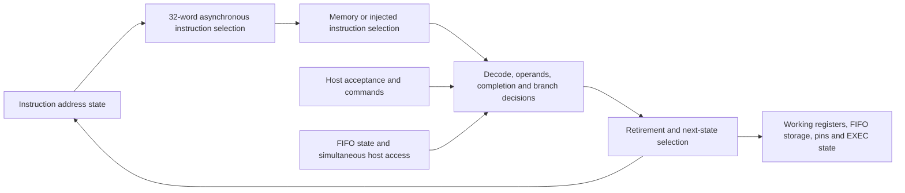

# Chip timing root-cause analysis: Outcome A versus Outcome B

Date: 2026-10-25. Design: `85506c60783641f7f0a14e13a7e099c9a9b9603f`.

This is an analysis-only report. No RTL, constraints, configuration, physical database, or existing experiment was changed. No new synthesis, placement, routing, or repair experiment was run. The only new project artifact is this report.

## 1. Finding and decision

**The evidence supports a mixed diagnosis, with Outcome A as the first remediation strategy, at medium confidence. It does not support the stronger claim that the architecture is already timing-safe and only routine final closure remains.**

There are substantial, directly measured implementation problems: weak drivers with large extracted loads, repeated buffer trees, long routes, and a flow that mapped for area at the typical corner with timing-driven placement disabled. On the worst internal path, buffers consume **8.783 ns** and one loaded NOR consumes **3.561 ns**. Together these account for **48.5% of the launch-clock-pin-to-data-pin delay**. This is strong evidence for investigating implementation before replacing the execution architecture. It is **not** a claim that 48.5% of the delay is removable.

There is also a real architectural concentration of work within one cycle: asynchronous instruction selection feeds instruction-dependent completion and data selection, which feed PC, register, FIFO, and pin updates. The worst mapped path has **30 non-buffer combinational stages**, and the 588 reported failing register-origin paths have a median of **28**. This is the specific Outcome B risk; it should not be dismissed as routing noise.

My recommendation is therefore:

1. **Do not commit to a new pipeline, memory architecture, or replacement core on the current evidence.** First test timing-oriented mapping and placement, plus extracted-load repair, under the existing functional contract.
2. **Do not assume unrestricted capability growth is safe until that test is resolved.** In particular, avoid extending the shared instruction-completion, branch-selection, or host/FIFO dependency chains without a timing budget.
3. If a timing-focused implementation still leaves substantial failures in these same cones, **take Outcome B locally**: redesign completion/commit and next-PC selection, then consider instruction predecode. A whole-chip rewrite is not presently justified.

This is a decision about the next engineering step, not proof that physical-only changes will close 50 MHz. Existing reports cannot cleanly assign a percentage of causation to architecture versus implementation because logical sharing creates fanout, and physical load increases the delay of the logical gates themselves.

## 2. Evidence and scope

I independently inspected the current production RTL, archived effective constraints, synthesis JSON and Verilog, complete slow-corner maximum-path report, per-port and register-only reports, electrical checks, previous routed experiments, and the existing WSL routing archive.

New analysis performed for this report:

- Reconstructed the synthesis Verilog's private net numbering from sorted hidden JSON net names; checked cell types and **all cell-port bit connections for 19,349 cells, with zero mismatches**.
- Classified all **616 failing endpoints** in the native slow-corner report using their mapped register Q signals.
- Counted logic/buffer stages and buffer delay across all **588 failing register-origin endpoint paths**.
- Recomputed the worst path's cell/net delay breakdown from its reported timing arcs.
- Recomputed the critical routed wire lengths from the archived DEF.
- Verified the archived routed netlist, SPEF, and effective SDC hashes against the existing replay manifest.
- Confirmed `git diff HEAD -- src info.yaml constraints` was empty. Existing uncommitted tools, tests, and reports were present before this investigation and were preserved.

The complete native slow report is in the ignored local archive at `test/sim_build/gds_failure_85506c6/runs/wokwi/55-openroad-stapostpnr/nom_slow_1p08V_125C/max.rpt`. Synthesis mapping sources are in that archive's `06-yosys-synthesis/`. Full physical geometry is under `/home/shane/eda/timing-20261024/current/runs/wokwi/` in Ubuntu-24.04 WSL.

Portable evidence retained in the repository:

- [Current corner summary](timing/85506c6/summary.rpt), [worst internal path](timing/85506c6/worst_slow_setup.rpt), and [original register-mapping evidence](timing/85506c6/register_mapping.json).
- [Per-port and mode results](timing/20261024/targeted_paths.json), [current replay manifest](timing/20261024/current_replay_manifest.json), and [environment provenance](timing/20261024/environment.json).
- [Routed experiment comparison](timing/20261024/comparison.md) and [experiment record](timing_experiments_20261024.md).
- [Prior implementation hypotheses](timing_hypotheses_20261025.md). These provide context; proposed improvements there are not measured successes.

The assessment concerns the archived **nominal-RC** slow, typical, and fast cell corners. It is not a new signoff run, an assessment of unprovided RC corners, or a functional/CDC proof.

## 3. Which timing checks actually fail?

The design targets a 20 ns clock, or 50 MHz. The archived SDC specifies 4 ns input/output delays, 0.25 ns clock uncertainty, 0.15 ns clock transition, propagated clocks, 0.95/1.05 early/late derates, 0.006 pF output loads, and maximum fanout 10. The current and historical effective SDC hashes match. The current production configuration requests all required corners for setup, hold, slew, and capacitance checks.

| Current result | Slow, 1.08 V / 125 C | Typical, 1.20 V / 25 C | Fast, 1.32 V / -40 C |
| --- | ---: | ---: | ---: |
| Worst setup slack, ns | **-6.809803** | +2.992410 | +7.564806 |
| Setup TNS, ns | **-979.921111** | 0 | 0 |
| Failing setup endpoints | **616** | 0 | 0 |
| Worst hold slack, ns | +0.666255 | +0.314691 | +0.122530 |
| Slew violations | **55** | **4** | 0 |
| Capacitance violations | 0 | 0 | 0 |
| Fanout violations | **183** | **183** | **183** |

These fanout counts are repeated checks of the design at each corner, not 549 distinct bad nets. Of the 183 violations, **174 are clock-buffer outputs and nine are other outputs**. Passing capacitance limits does not imply the loads are small enough for good timing.

All current reported hold TNS/counts are zero. The fast hold margin is nevertheless small enough that aggressive setup repair must be rechecked for hold. Neither typical-corner success nor functional simulation qualifies slow-corner operation.

### Reset is no longer the dominant failure

| Slow-corner query | Historical `37c74dc`, ns | Current `85506c6`, ns |
| --- | ---: | ---: |
| Global setup, reset dynamic | -5.885337 | **-6.809803** |
| Register-only setup, reset dynamic | -3.418458 | **-6.809803** |
| Global setup, reset held inactive | -3.842775 | **-6.809803** |
| Reset rise setup | -5.885337 | +1.776970 |
| Reset fall setup | -4.305575 | +2.097446 |
| Worst non-reset input setup | -3.854863 | **-4.812579** |
| Worst output/OE setup | +5.617109 | +4.144582 |

The previous reset-related change removed the dominant reset failure but did not solve the underlying execution/control problem. Internal violations already existed in the historical design. The current register-only worst slack is 3.391345 ns worse; this comparison alone does not isolate whether the regression came from Boolean restructuring, mapping, placement, or routing.

Holding reset inactive leaves the current worst failure unchanged. Thus waiving reset or changing reset sequencing cannot explain away this failure. Reset-active case analysis is diagnostic only; it does not qualify real reset transitions.

The native annotation report lists 137 raw unannotated drivers; the flow's filtered unannotated-net count is zero. The existing replay reports recorded no coverage-check issues. I did not interpret the raw count as 137 missing functional timing paths, nor claim that coverage proves every protocol constraint correct.

### Host control also participates in failing paths

Independent per-port queries expose alternatives hidden by the global report's single worst path per endpoint:

| Current slow input path | Worst slack, ns |
| --- | ---: |
| `ena` | -2.978935 |
| Host address `ui_in[0]` | -3.821802 |
| Host address `ui_in[1]` | **-4.812579** |
| Host address `ui_in[2]` | -4.484401 |
| Host address `ui_in[3]` | -4.238961 |
| Host write/read controls `ui_in[4]` / `[5]` | -3.424448 / -3.587759 |
| Host data `uio_in[0]` / `[1]` | -0.849523 / -1.722695 |

All these worst queried paths end at `_33839_`, the same inferred instruction-read address state as the global worst path. The remaining host data bits pass their input queries. The six protocol input ports have positive setup slack to their first sampling registers. All queried external data and output-enable paths pass setup; however, the internal pin-state registers themselves do have failing input paths.

These are constrained same-cycle host paths. The fact that software sends host traffic slowly does not itself establish a multicycle exception.

## 4. What the worst internal path contains

The path starts at `_33835_/Q` and ends at `_33839_/D`. Verified JSON mapping identifies these as engine 1's inferred instruction-memory read-address state, bits 0 and 4. The synthesis log explicitly records merging address flip-flops into memory read ports and later extracting their address state.

**These are address-state bits, not instruction-word data bits or evidence of a new registered instruction-output stage.** The original RTL still reads instruction memory asynchronously. The native report also contains separate failing architectural `current_pc` registers, so the inferred address-state names should not simply be substituted for every source-level PC register.

| Worst-path contribution | Delay, ns | Interpretation |
| --- | ---: | --- |
| Launch clock-to-Q | 0.315679 | Sequential-cell arc |
| 17 buffer output arcs | **8.783121** | Distribution/implementation cost |
| Terminal `_23246_` NOR4 output arc | **3.561205** | One especially slow, loaded logic driver |
| Other 29 non-buffer logic arcs | **12.393449** | Selection/control logic, with its actual input slew and loads |
| Explicit interconnect increments | 0.412800 | Wire propagation increments reported separately by STA |
| Total launch CLK pin to destination D | **25.466254** | Sum of the above, subject to printed rounding |

Launch-clock arrival is 1.241389 ns and data arrival is 26.707644 ns. Capture-clock arrival is 21.098352 ns. After uncertainty, clock reconvergence pessimism correction, and **1.067971 ns setup time**, required arrival is 19.897840 ns: **-6.809803 ns slack**.

Clock skew is not a plausible explanation for most of this deficit: capture-minus-launch insertion delay is approximately -0.143 ns, partly offset by +0.117 ns reconvergence correction. The dominant cost is in the data cone.

### Why small explicit wire delay does not establish Outcome B

Only 0.413 ns appears as explicit wire propagation, but cell delay is computed with the extracted load and input slew. A long wire can therefore appear mainly as a slower driving-cell arc and a worse downstream setup requirement. It would be incorrect to label all 25.053 ns of cell-arc delay as irreducible RTL logic delay.

For `_23246_/Y`, the report gives:

- `sg13cmos5l_nor4_1`, fanout **one**, load **0.178745 pF**.
- Gate delay **3.561205 ns**, output slew **4.579258 ns**, receiving D slew **4.583533 ns**.
- Driver placement at (336.960, 453.600) um and destination placement at (757.440, 457.380) um.
- Net `_01516_` routed length **1253.22 um**: 797.22 um on Metal4, 421.08 um on Metal3, and 34.92 um on Metal2.

The cells are only about 424.26 um apart by Manhattan distance between placement origins. That is approximately a threefold route detour; pin locations differ from cell origins. This is strong physical evidence even though logical fanout is one. Another worst-path connection, `_10727_`, measures **529.38 um** of routed wire.

The 17 buffers are distributed across several parts of the path. They are not a single redundant chain that can safely be deleted. Some buffering is necessary, and hold requirements must remain satisfied.

Even the unrealistic removal of the entire terminal NOR delay **and the entire receiving setup requirement** would recover only 4.629176 ns, leaving about **2.181 ns** of this path's deficit under otherwise fixed conditions. Other endpoints would remain. Thus a terminal-gate-only fix cannot establish chip-wide closure.

## 5. Is the failure localized or architectural in breadth?

The complete native slow report contains 616 negative-slack paths to 616 unique endpoints:

- 306 launch at engine 1 address-state bit 0, `_33835_`.
- 280 launch at engine 0 address-state bit 2, `_33851_`.
- Two launch at engine 0 address-state bit 3, `_33852_`.
- 28 launch at host address `ui_in[2]`.

Thus **588/616, or 95.5%, of the reported endpoint-worst failures launch from just three instruction-address state bits**. This identifies a shared upstream problem rather than hundreds of unrelated local problems. It does not imply that only three launch registers have any failing alternatives; the per-port queries already demonstrate otherwise.

Independent endpoint classification gives:

| Destination family, both engines combined | Failing endpoints | Worst slack, ns |
| --- | ---: | ---: |
| Inferred execution instruction-read address state | 10 | -6.809803 |
| Architectural `current_pc` | 10 | -3.001032 |
| Pin-value registers | 24 | -3.790978 |
| Direction registers | 8 | -3.684488 |
| Injected `exec_instruction` | 32 | -3.643081 |
| X and Y working registers | 126 | -2.945731 |
| ISR and OSR | 128 | -2.674865 |
| RX FIFO storage | **256** | -2.573408 |
| RX FIFO write-pointer / level bits | 2 | -2.640167 |
| TX FIFO storage | 6 | -0.093136 |
| IRQ state | 8 | -1.538261 |
| Input/output bit-count state | 6 | -1.154193 |
| **Total** | **616** | **-6.809803** |

RX FIFO storage alone contributes approximately **-396.883 ns**, or **40.5% of total setup TNS**. This is an aggregate-delay symptom, not proof that the FIFO storage array is the original bottleneck: its write acceptance depends on upstream instruction/control signals.

Across the 588 reported register-origin failing paths:

- Combinational stages including buffers: **36 minimum, 44 median, 53 maximum**.
- Non-buffer combinational stages: **22 minimum, 28 median, 34 maximum**.
- Median total buffer-arc delay: **8.416881 ns**.

The first 15 combinational output arcs of the worst path are shared by all 306 engine-1-origin paths in this report. Repairing shared upstream distribution or logic can therefore have much broader value than optimizing one destination. Conversely, replacing only the final NOR leaves the shared bottleneck intact.

These counts describe this mapped implementation. They are not a technology-independent lower bound on the logic depth the ISA requires.

## 6. RTL dependencies and growth risk

The following is the source-level dependency structure, not a claim that every named RTL expression has been mapped to an individual gate on the worst STA path:



### Highest-risk architecture: shared completion and PC update

In [protocol_core.sv](../src/protocol_core.sv), lines 54–84 select fetched versus injected instruction and compute `retire = attempt && !stall && !illegal && !halt`. PC advance also depends on `exec_pending` and `branch`. The opcode block at lines 161–257 computes stalls, branches, resource requests, and candidate state updates. Retirement then controls many destinations at lines 364–376.

The fetch-to-completion-to-update chain has no intervening execution register. New instruction modes or completion conditions can add selection depth or increase fanout in this same cycle. This is a credible **Outcome B growth risk**.

However, the named decoder module is mostly field extraction and legality checking. It would be misleading to blame that file alone. The effective decode/control function spans the core, resource selection, and state-update priorities. Internal ABC names do not preserve enough source correspondence to identify every critical mapped gate with a specific source expression.

### Host/FIFO interaction is a second important boundary

The host adapter's `write_intent` and `read_intent` are combinational functions of current pins and stored transaction state. They pass through engine selection and [pio_host_bank.sv](../src/pio_host_bank.sv), which derives commands, complete-word writes, and snapshot reads.

Within the core, lines 96–102 compute:

```text
host_rx_pop = snapshot_read && data_address == 9
rx_room     = !rx_full || (host_rx_pop && !rx_empty)
retire      = attempt && !stall && !illegal && !halt
rx_push     = retire && rx_push_request
```

Blocking PUSH and auto-push can make `stall` depend on `rx_room`. [pio_fifo.sv](../src/pio_fifo.sv), lines 15–16, then qualifies `take_pop` and `take_push` again for full/empty and simultaneous operations. This creates a legitimate same-cycle dependency from host acceptance to execution completion and storage update. There is no combinational feedback loop in these equations, but there is a long dependency chain.

The host-to-PC failures and failed experiment's host-to-RX-FIFO path are consistent with this risk. They do not establish that the exact worst current host path goes through every expression above. Command START/STOP/group-control paths also reach execution state and require separate cone tracing before choosing a rewrite.

### Data selection and computed branches

Source selection chooses among pins, X, Y, FIFO status, ISR, and OSR. MOV transformations and OUT's auto-pull selection can feed computed PC targets or injected instructions. Therefore some PC feedback is data-dependent, not just a small incrementer and branch mux. Adding more shared operands or destinations can grow this cone.

The 32-bit variable shifters and configuration-dependent pin masks deserve timing budgets, but the available gate correspondence does **not** establish a barrel shifter as the principal measured bottleneck. Their presence in RTL alone is insufficient reason to rewrite them first.

### Architectural boundaries that are already helpful

Each engine has its own instruction memory, working state, and TX/RX FIFO storage. There is no per-instruction arbiter granting a shared execution unit between the two engines. GPIO ownership is stable while engines run and selects their registered outputs. Input sampling is registered. All queried external output/OE setup paths pass.

This argues against replacing the dual-engine structure or adding output pipelines as the first response. More firmware that fits the existing instruction memory does not add RTL gates. New hardware instructions, wider memories, more engines, or expanded shared selection can increase timing cost and must be assessed separately.

## 7. Implementation evidence for Outcome A

The archived `resolved.json` directly records:

| Setting | Archived value | Implication |
| --- | --- | --- |
| `SYNTH_STRATEGY` | `AREA 0` | Area-oriented technology mapping |
| `SYNTH_CORNER` | `null` | Default corner selected by the recorded flow |
| `DEFAULT_CORNER` | `nom_typ_1p20V_25C` | Mapping was not optimized specifically for failing slow setup |
| `SYNTH_ABC_BUFFERING` / `SYNTH_SIZING` | `false` / `false` | These synthesis options were disabled; later physical repair still exists |
| `PL_TIMING_DRIVEN` | `false` | Timing-driven global placement was disabled |
| `PNR_CORNERS` | `null` | Actual optimization views must be checked in emitted logs |

The prior pinned-source investigation records typical-only global-placement views, while resizer and final signoff steps load all three corners. Thus this is a mismatch in optimization emphasis, **not missing slow-corner signoff**. A future experiment must verify the actual placement views rather than assume the final signoff list controls them.

Additional directly checked physical evidence:

- Post-placement repair inserted **2,715 buffers across 604 nets**. The earlier log analysis records zero resized cells in that step.
- Post-CTS timing repair reported **no setup violations** under its estimated parasitics and inserted **2,767 hold buffers**. Final extracted slow setup subsequently failed.
- Global routing finished with residual overflow: **2 on Metal2 and 178 on Metal3**. This demonstrates local congestion despite approximately **30.6% cell-area utilization**; low utilization does not prove short or uncongested routes.
- The critical single-load NOR net has the independently verified 1.253 mm route and slow transition described above.

These observations establish meaningful implementation opportunity. They do not prove that every buffer is unnecessary, that the router is defective, or that more cell area will automatically improve timing.

## 8. What previous experiments do and do not prove

These are prior measured results, not changes made during this analysis. All use the 20 ns target and fresh routed/extracted timing for their respective candidates.

| Prior candidate | Slow WNS, ns | Slow TNS, ns | Failing endpoints | Result relevant to A/B |
| --- | ---: | ---: | ---: | --- |
| Unchanged control | -6.809803 | -979.921111 | 616 | Reference |
| Post-global-route electrical repair | -6.669463 | -1166.127309 | 628 | Small WNS gain; aggregate regression |
| CTS cluster size 8 | -7.193721 | -1130.830501 | 618 | Clock fanout improvement did not fix setup |
| CTS plus branch split | -6.776606 | -1055.483069 | 625 | Removed clock fanout violations; seven data fanout violations remained |
| Post-global-route timing repair | -6.485150 | -1179.156390 | 629 | Best WNS gain only about 0.325 ns; aggregate regression |
| Parallel instruction-read RTL, reverted | -9.486900 | -4689.111070 | 927 | Worse chip-wide result despite altered fetch selection |

The best physical-only WNS gain recovered only about **4.8% of the original worst deficit**. None of these candidates closed timing. This is evidence against treating late repair switches or CTS tuning as sufficient.

It is **not** a controlled rejection of Outcome A in general: these physical trials did not redo technology mapping for delay or enable timing-driven global placement from the original synthesized netlist. Those are major untested variables.

The parallel-read experiment also does not prove that architectural work is futile. It changed the instruction-read Boolean structure without adding an execution boundary or shortening the full completion/commit chain. Its register-only WNS improved to -6.197446 ns, but the global worst moved to a host input reaching RX FIFO storage. That demonstrates bottleneck migration and the need to assess the whole chip, not just the original PC path.

## 9. Decision criteria for future work — not executed

### First test whether Outcome A is sufficient

The smallest useful investigation would separate these mechanisms:

1. Extracted-load sizing/buffering and route repair around the worst weak drivers, including `_23246_`, while checking competing paths.
2. Timing-driven placement with verified slow-corner optimization views, keeping the logical netlist fixed for attribution.
3. Delay-oriented mapping, followed separately by synthesis-corner comparison, then physical evaluation of promising results.
4. Integration of clock-fanout correction only with a candidate whose setup, hold, slew, and remaining data fanout are acceptable.

Evidence supporting Outcome A would be broad improvement in the shared failing families, not just the worst endpoint, with all required setup/hold and electrical checks eventually passing under the current RTL behavior. A few tenths of a nanosecond of WNS improvement accompanied by worse TNS is insufficient.

### When to choose Outcome B

Choose a localized architecture redesign if timing-focused implementation removes the extreme electrical penalties yet the same instruction-selection/completion/update cones retain material negative slack, or if planned new functionality necessarily lengthens those cones. Multiple optimized mappings and placements remaining dominated by the same logical dependencies would make that decision much stronger than the current area-oriented baseline does.

Prioritize architectural work as follows:

| Priority | Structure | Direction to investigate | Main contract to preserve |
| --- | --- | --- | --- |
| 1 | Completion/commit and FIFO acceptance | Parallel per-class completion predicates and shallow local commit equations | Atomic stalls; full FIFO simultaneous pop/push; ordering |
| 2 | Next-PC and branch selection | Compute alternatives in parallel and shorten final selection | Taken branches, wrap, restart, dynamic EXEC semantics |
| 3 | Static instruction decode | Store selected predecode with program words and decode injected instructions at capture | Program-write visibility, legality, one-cycle ordinary retirement |
| 4 | Fetch organization / execution staging | Consider only after the remaining cone is established | Arbitrary computed branches and externally visible instruction timing |

Duplicating small local control terms or predecoding instructions can change architecture internally without adding a visible instruction cycle. Their area, clock-load, and routing cost must still be measured. Blindly widening instruction storage can make the physical problem worse.

A new pipeline or synchronous instruction SRAM would be a larger contract change. Prefetch alone does not resolve the dependencies of arbitrary computed branches and EXEC injection. Such a change should follow a deliberate throughput/latency decision, not be treated as a transparent timing fix.

For any later candidate, compare fresh extracted WNS, TNS, endpoint families, hold, slew, capacitance, fanout, annotation coverage, and area/congestion. Functional or equivalence checks must match the scope of the change. Final physical acceptance also requires completed DRC/LVS and project prechecks. No exceptions, relaxed clock target, or changed acceptance limits are proposed here.

## 10. Confidence and remaining uncertainty

| Conclusion | Confidence |
| --- | --- |
| Current setup failure is not primarily reset or external output timing | High |
| Shared instruction-address/control cones dominate reported failures | High |
| Physical loading, routing, and buffer distribution contribute materially | High |
| Extending shared completion/resource selection creates architectural timing risk | High as an RTL dependency observation; unmeasured for future features |
| Timing-focused implementation should precede a major architecture replacement | Medium; an engineering recommendation from the untested options |
| Physical-only changes can close every required check at 50 MHz | **Unproven** |
| The current instruction contract inherently requires a pipeline redesign | **Unproven** |

The key missing evidence is a controlled, timing-focused implementation with path-to-RTL correspondence for the remaining critical cones. This analysis establishes where the failures occur and why both physical repair and architectural discipline matter; it does not replace that measurement with a promised outcome.
